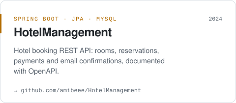
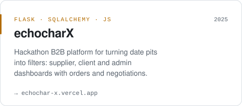
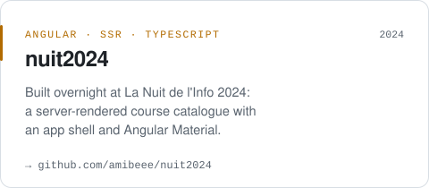
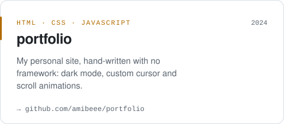
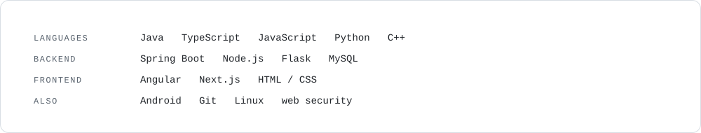

<picture><source media="(prefers-color-scheme: dark)" srcset="./assets/header-dark.svg"></picture>

I'm a computer science student from Tunis. I like the whole path from a database schema to the pixel on screen, and lately I'm just as interested in how that path gets broken: input validation, auth flows, the boring bugs that turn into real holes.

Most of what's here are school labs, hackathon nights and small builds. The four below are the ones I'd show you first.

&nbsp;

<a href="https://github.com/amibeee/HotelManagement"><picture><source media="(prefers-color-scheme: dark)" srcset="./assets/hotelmanagement-dark.svg"></picture></a>
<a href="https://echochar-x.vercel.app"><picture><source media="(prefers-color-scheme: dark)" srcset="./assets/echocharx-dark.svg"></picture></a>

<a href="https://github.com/amibeee/nuit2024"><picture><source media="(prefers-color-scheme: dark)" srcset="./assets/nuit2024-dark.svg"></picture></a>
<a href="https://amibeee.github.io/portfolio/"><picture><source media="(prefers-color-scheme: dark)" srcset="./assets/portfolio-dark.svg"></picture></a>

&nbsp;

<picture><source media="(prefers-color-scheme: dark)" srcset="./assets/stack-dark.svg"></picture>

&nbsp;

<picture>
  <source media="(prefers-color-scheme: dark)" srcset="https://raw.githubusercontent.com/amibeee/amibeee/output/snake-dark.svg">
  
</picture>

Open to internships and hackathon teams · <a href="https://amibeee.github.io/portfolio/">amibeee.github.io/portfolio</a>
