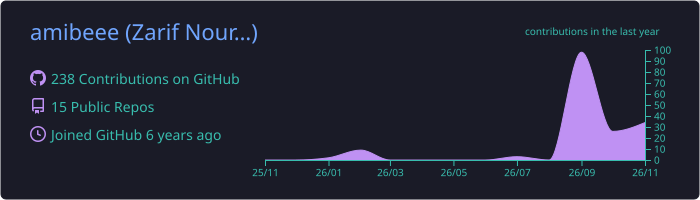
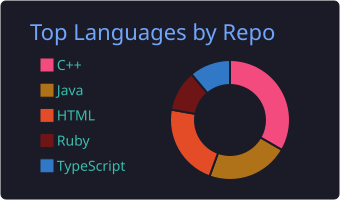
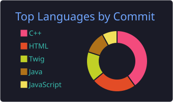
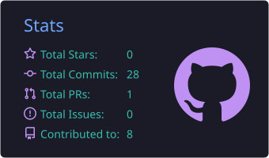
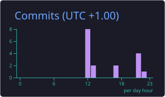

<!-- Header -->
<p align="center">
  
</p>

<p align="center">
  <a href="https://github.com/amibeee">
    
  </a>
</p>

<p align="center">
  
  
  
</p>

---

### 🧑‍💻 About me

```ts
const zarif = {
  role:       "Software engineering student & full-stack developer",
  code:       ["Java", "C++", "TypeScript", "JavaScript", "HTML/CSS"],
  backend:    ["Spring Boot", "Node.js", "Express"],
  frontend:   ["Next.js", "React"],
  mobile:     ["Android (Java)"],
  currently:  "Leveling up in algorithms, clean architecture & AI tooling",
  funFact:    "I build things at hackathons (Nuit de l'Info 2024 🌙)",
};
```

- 🔭 Working on full-stack apps — from **Spring Boot APIs** to **Next.js dashboards** and **Android TV apps**
- 🌱 Learning **cloud, DevOps & AI integrations**
- 🤝 Open to **internships, collaborations and hackathon teams**
- ⚡ Fun fact: I like turning pseudo-code into real, working software

---

### 🛠️ Tech stack

<p align="center">
  <a href="https://skillicons.dev">
    
  </a>
  <br/>
  <a href="https://skillicons.dev">
    
  </a>
</p>

---

### 🚀 Featured projects

| Project | What it is | Stack |
|---|---|---|
| 🏨 [**HotelManagement**](https://github.com/amibeee/HotelManagement) | Hotel management REST backend |   |
| 📊 [**nextjs-admin-panel**](https://github.com/amibeee/nextjs-admin-panel) | Admin dashboard for SOTUPUB |   |
| ⚙️ [**nodejs-backend**](https://github.com/amibeee/nodejs-backend) | API backend for SOTUPUB |   |
| 📺 [**android-tv-app**](https://github.com/amibeee/android-tv-app) | Android TV client for SOTUPUB |   |
| 🌙 [**nuit2024**](https://github.com/amibeee/nuit2024) | Nuit de l'Info 2024 hackathon project |  |
| ✨ [**echocharX**](https://github.com/amibeee/echocharX) | Cross hackathon project |  |

---

### 📊 GitHub stats

<p align="center">
  
</p>
<p align="center">
  
  
</p>
<p align="center">
  
  
</p>

<p align="center">
  
</p>

<p align="center">
  
</p>

---

### 🐍 Contribution snake

<p align="center">
  <picture>
    <source media="(prefers-color-scheme: dark)" srcset="https://raw.githubusercontent.com/amibeee/amibeee/output/github-snake-dark.svg" />
    <source media="(prefers-color-scheme: light)" srcset="https://raw.githubusercontent.com/amibeee/amibeee/output/github-snake.svg" />
    
  </picture>
</p>

---

### 🤝 Let's connect

<p align="center">
  <a href="https://github.com/amibeee"></a>
  <a href="https://github.com/amibeee/portfolio"></a>
</p>

<p align="center">
  
</p>
